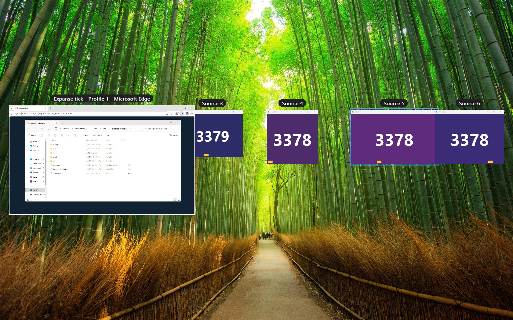

# Expanse for Windows

A Windows port of [Expanse](https://github.com/invig/expanse), the infinite-canvas window
manager: every window has its own place on one endless desktop; zoom out to see them all, click
one to glide straight to it.

<p align="center"></p>

Early days. What works so far:

- **Zoom out** with <kbd>Ctrl</kbd> <kbd>Alt</kbd> <kbd>`</kbd> (the key below <kbd>Esc</kbd>, on any
  layout): every window, live, at its spot on the canvas, with its app's name above it (the window's
  title too when the pointer is on it).
- **Click a window** to glide to it at 100%, centred in the work area and focused. The other windows
  move with the canvas, off-screen if that's where the camera puts them.
- <kbd>Ctrl</kbd> <kbd>Alt</kbd> + arrow keys **hop to the nearest window in that direction**,
  glide to it and focus it (Ctrl+arrows is word-jump in every app and Win+arrows is Snap, so
  Ctrl+Alt). Zoomed out, the arrows alone move the highlight and the view follows; <kbd>Return</kbd>
  dives into it.
- **Drag a window's picture while zoomed out** to move it on the canvas. It snaps to other windows'
  edges and centres, the standard 20 px gap, a whole row or column, and the middle of the screen,
  with pink guides. Hold <kbd>Ctrl</kbd> to move it freely (⌘ on the Mac). The real window follows
  when you go back to 100%.
- **Tidy Up** (<kbd>T</kbd> zoomed out, or the tray menu) tidies each group of windows where it is:
  overlaps pushed apart, edges that nearly line up lined up, gaps closed to 20 px. Everything glides
  to its new spot.
- **New windows open in free space** next to the window you were in (right, below, left, then above),
  as on the Mac; the view glides there if that's off screen. A window coming back from being
  minimised goes back to its own spot.
- **Getting around zoomed out**, as on the Mac: the mouse wheel (or a touchpad's two-finger
  scroll) pans, sideways with <kbd>Shift</kbd> or a tilt wheel; <kbd>Ctrl</kbd>+wheel (or a pinch)
  zooms around the pointer; or hold <kbd>Space</kbd> and drag. <kbd>0</kbd> fits every window,
  <kbd>1</kbd> zooms to 100%, <kbd>-</kbd> and <kbd>=</kbd> zoom out and in. <kbd>Esc</kbd> or the
  hotkey again goes back to where you were, or, once you've moved the view, to 100% where you're
  looking.
- **Select several windows** with <kbd>Shift</kbd>-click, by dragging a box over empty canvas
  (<kbd>Shift</kbd> adds to the selection), or with <kbd>Ctrl</kbd> <kbd>A</kbd>; <kbd>Esc</kbd>
  clears it. Dragging any of them moves them all, snapping as one block.
- **Close windows from the canvas** with the × at the top right of the picture under the pointer
  (on every selected window when it's one of them), or <kbd>Ctrl</kbd> <kbd>W</kbd> (the selection,
  otherwise the window under the pointer). A window that asks first ("Save changes?") is brought up
  so you can answer.
- **Windows are tracked live.** New windows join the canvas where they open, closed ones leave it,
  and moving a window moves its spot. Zoomed out, pictures appear and disappear as windows come and
  go.
- **Picking a window that isn't fully on screen glides to it.** That covers the taskbar, Alt-Tab, or
  an app bringing its window forward. This is the Mac's Auto-Centre, and it's on the tray menu.
  Focus coming back to the window you were already in (after the taskbar or Start menu) doesn't
  count.
- **A tray icon** (Expanse's glyph from the Mac menu bar): click it to zoom out, right-click for
  the menu: Open, Pause/Resume, Auto-Centre Focused Window, Desktop Picture Background, Quit.
  Windows 11 puts new tray icons in the overflow (^); drag it onto the taskbar to keep it in view.
- **The canvas is saved** (`%LOCALAPPDATA%\Expanse\layout.json`, a second after changes, and on
  pause or quit). Starting again puts the view and every window back where they were. An app opened
  later that had windows last time gets their spots back. Windows are matched by the same window
  while its app keeps running, then by app and title, then by app. Titles are stored only as
  hashes.
- **At home on any screen size.** Each window keeps a home spot (its place in the full-size
  layout) and the size you chose (by dragging an edge). When the screen changes (resolution,
  scale, taskbar), the layout is fitted from home:
  - sizes go back to what you chose, capped at the screen;
  - positions are derived so every gap keeps its size, and only the overlaps the smaller screen
    caused are pushed apart;
  - the window you were in goes in the middle.

  A smaller screen tightens the layout; going back puts it back exactly. Moves you make on the
  smaller screen carry over. Tidy Up tidies the home layout and caps window sizes too.
- **Restore Layout** (tray menu): a snapshot of the layout is taken when it has changed and the
  last one is 15 minutes old; the newest three are kept. Picking one puts every window back where
  it had them, fitted to this screen and shown zoomed out. The layout it replaces becomes a
  snapshot, so you can go back.
- **Dialogs go with their window.** Windows doesn't move a dialog (Find, Properties, "Save
  changes?") when its owner moves, so Expanse does: each keeps its place by its window, moves and
  shows with it zoomed out, and clicking its picture goes to the window. Move a dialog yourself and
  it keeps the new place. A dialog that opens while its window is off screen goes onto its window,
  and clicking the window's taskbar button (or anything that focuses the dialog) glides there.
- **Maximised windows are screen-sized windows on the canvas.** Windows won't move a maximised
  window, so when the view moves off one, Expanse makes it an ordinary window of the same size to
  move it, and maximises it again when you come back to it. Un-maximising it yourself gives you
  back your own size.
- **Pausing or quitting** puts every window back where it was before Expanse moved it, as does the
  next start after a crash (`Expanse.exe --restore` does it by hand).

C# / .NET 10, built for ARM64 for now (the dev VM). Live pictures are DWM's shared thumbnail
visuals, with plain DWM thumbnails as the fallback. See [docs/spikes.md](docs/spikes.md) for why,
and for what's next.

## How it works

Same model as the Mac app ([how it works](https://github.com/invig/expanse/blob/main/docs/how-it-works.md)):
a camera (origin and scale) over one canvas, each window at a fixed spot.

- **At 100% windows are real** and sit exactly where the camera puts them. Unlike macOS, Windows lets
  a window sit wholly off-screen, so there's no corner parking.
- **Zoomed out** a full-screen, topmost overlay rises with a live picture of every window, first
  exactly over the real windows, then animated out (ease-out cubic, 0.22 s; scale interpolated in log
  space, as on the Mac).
- **The pictures are DWM shared thumbnail visuals:** DirectComposition visuals that DWM fills with
  each window, in a visual tree over the overlay. Each sits at its canvas spot inside one canvas
  visual, so the camera is a single transform per frame. The API is undocumented (dwmapi #147). If
  it's missing or fails, Expanse falls back to documented DWM thumbnails, one call per picture per
  frame. `Expanse.exe --pictures dwm` forces the fallback.
- **Our UI is in the same tree, over the pictures:** titles (Direct2D/DirectWrite, drawn once per
  text), the hover and selection rings, the marquee, close buttons and snapping guides. Everything
  that moves with the camera changes in one composition commit per frame. With the fallback, DWM
  draws its thumbnails over everything, so titles and rings go on the backdrop underneath, and
  there are no close buttons (<kbd>Ctrl</kbd> <kbd>W</kbd> still works).
- **Off-screen windows come on-screen underneath the overlay** while it's up. GDI-drawn apps
  (classic Win32, Explorer's file list) only paint the parts of a window that are on a screen, so
  parked ones would otherwise show stale or empty pictures.
- **Clicking one** animates the camera to it (0.18 s), then moves every real window once
  (`SetWindowPos`, asynchronous so a hung app can't stall it), waits for the ones in view to land,
  focuses the window and drops the overlay.
- Animation runs a frame at a time on the UI thread, paced by `DwmFlush`.
- **Window events** come from `SetWinEventHook`, out of context (nothing is injected into other
  apps), on the UI thread. Comings, goings and moves are gathered into one sync 50 ms after the last
  of them; focus acts where it settles, 120 ms later.

## Layout

| Path | What |
|---|---|
| `src/Expanse` | The app |
| `src/Ctl` | `expansectl`: sends commands to the running app over a named pipe |
| `src/Guest` | Test helper on the VM's desktop: screenshots, clicks, keys, the wheel |
| `src/Spikes` | Week-one experiments (pictures, parking, focus) |
| `src/Layout` | The canvas maths (nearest window, Tidy Up, free spots, snapping) and geometry, no Windows APIs |
| `src/Layout.Tests` | Its tests: by hand, and against the Mac app's own Swift on random layouts |
| `src/Native` | Hand-written Win32 declarations shared by all of them |
| `scripts/vm.sh` | Drives the dev VM from the Mac |

## Developing (from the Mac, against the UTM VM)

The dev machine is a Windows 11 on Arm VM in UTM on the Mac, reached over SSH. Programs started
over SSH can't show windows, so anything that needs the desktop runs through a scheduled task in
the signed-in session (`scripts/guest/desk.ps1`).

```bash
scripts/vm.sh setup         # once: OpenSSH with this Mac's key, the .NET 10 SDK
scripts/vm.sh build         # sync the source over and build everything
scripts/vm.sh start         # (re)start Expanse on the VM's desktop
scripts/vm.sh ctl zoomout   # or: pick <title>, back, state, windows, log, pause, resume, bench 5, quit
scripts/vm.sh ctl screen 640 480   # pretend the screen is that size (no size: the real one)
scripts/vm.sh shot          # out/shot.png: the VM's screen
scripts/vm.sh test          # the layout maths' tests
```

**The layout maths is a line-for-line port of the Mac app's** (nearest window, derive, separate,
clusters, Tidy Up, free spots, snapping). `scripts/layout-oracle.py` takes those functions from the
Mac checkout (`../CANVAS`), runs them on random layouts with Swift, and writes
`tests/layout-fixtures.json`. `src/Layout.Tests` requires the C# to give exactly the same answers.
Run the script again when the Mac's maths changes.

Settings live in `%LOCALAPPDATA%\Expanse\settings.json`. Expanse logs to
`%LOCALAPPDATA%\Expanse\expanse.log` in the VM (`scripts/vm.sh ctl log` shows the
end of it).
