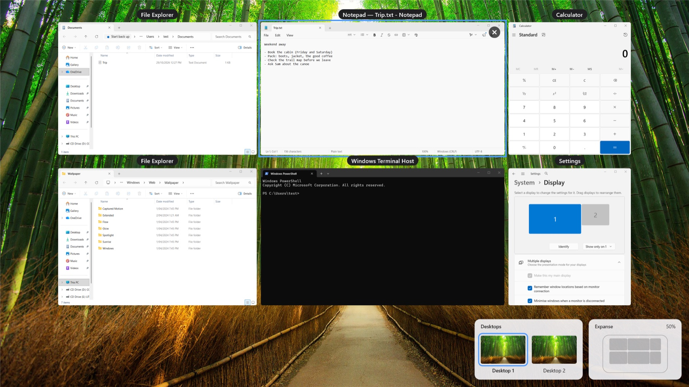

<p align="center">
  
</p>

<p align="center">
  <strong>Every window gets its own place on one endless desktop.</strong><br>
  Zoom out to see them all. Click one to glide straight to it.
</p>

<p align="center">
  <a href="https://github.com/invig/expanse-windows/releases/latest"><strong>Download</strong></a> ·
  <a href="#install">Install</a> ·
  <a href="#the-basics">How to use it</a> ·
  <a href="#questions">Questions</a> ·
  <a href="https://github.com/invig/expanse">Expanse for Mac</a>
</p>

<p align="center">
  
  
</p>

---

Expanse treats your screen as a view onto a much bigger canvas. Your windows stay where you put
them on it; you move the view instead of the windows. Rest the pointer in a corner of the screen
to see everything at once, then click a window to fly to it, ready to use.

It's [Expanse for Mac](https://github.com/invig/expanse) for Windows, following the same layout
rules line for line.

- **See everything at once.** Every window, live, laid out the way you arranged it.
- **Move around by direction.** <kbd>Ctrl</kbd> + <kbd>Alt</kbd> + arrow keys hop to the next
  window to the left, right, above or below.
- **Arrange like a design tool.** Drag windows around; they snap into neat, even gaps. New
  windows open beside the one they came from.
- **At home on a laptop or a big display.** On a smaller screen the layout tightens up, columns
  staying lined up, and plugging back in puts it back exactly.
- **Easy to leave.** Pause or quit and every window goes straight back to where it was.

## Install

[Download the latest version](https://github.com/invig/expanse-windows/releases/latest): **x64**
for most PCs, **arm64** for Windows on Arm (Snapdragon laptops, Surface Pro X). Unzip it into a
folder of your own, somewhere in your user folder rather than Program Files so Expanse can update
itself, and run **Expanse.exe**. It's a single file with nothing else to install, runs on
Windows 11, and keeps itself up to date.

Expanse isn't code-signed yet, so the first time, Windows may say *Windows protected your PC*:
choose **More info**, then **Run anyway**.

## First launch

There's nothing to grant: Windows lets Expanse move windows and show their pictures as it is. A
Welcome window shows the shortcuts and where the hot corner is, and says if another app already
uses one of Expanse's keys.

Expanse lives in the tray. Windows 11 tucks new tray icons under <kbd>^</kbd> on the taskbar:
drag Expanse's onto the taskbar to keep it in reach, and pick **Open at Login** from its menu to
start it with Windows.

## The basics

| Do this | To |
|---|---|
| Rest the pointer in a screen corner, or press <kbd>Ctrl</kbd> + <kbd>Alt</kbd> + <kbd>`</kbd> | Zoom out to every window (do it again to go back) |
| Click a window | Glide to it and start using it |
| <kbd>Ctrl</kbd> + <kbd>Alt</kbd> + <kbd>←</kbd> <kbd>→</kbd> <kbd>↑</kbd> <kbd>↓</kbd> | Hop to the next window in that direction |
| Scroll, or pinch | Move around the canvas, and zoom |
| Drag a window while zoomed out | Move it; it snaps into place |
| <kbd>T</kbd> | Tidy up: each group of windows lined up and evenly spaced, where it is |
| <kbd>Esc</kbd> | Back to 100% |

<kbd>`</kbd> is the key below <kbd>Esc</kbd>, whatever your keyboard layout.

<details>
<summary><strong>All shortcuts</strong></summary>

| Do this | To |
|---|---|
| <kbd>Ctrl</kbd> + <kbd>Alt</kbd> + <kbd>C</kbd> | Centre the window you're in |
| <kbd>Ctrl</kbd> + scroll | Zoom around the pointer |
| <kbd>Shift</kbd> + scroll | Move sideways |
| <kbd>Space</kbd> + drag | Move around the canvas |
| Click empty desktop | Zoom out to every window |
| Scroll on empty desktop | Start moving around the canvas from 100% |
| Click or drag in the minimap | Move the view there |
| Drag on empty canvas, <kbd>Shift</kbd>-click, or <kbd>Ctrl</kbd> + <kbd>A</kbd> | Select windows, then drag any of them to move the group |
| Hold <kbd>Ctrl</kbd> while dragging | Move without snapping |
| <kbd>0</kbd> · <kbd>1</kbd> · <kbd>-</kbd> · <kbd>=</kbd> | Fit everything · 100% · zoom out · zoom in |
| Arrow keys · <kbd>Return</kbd> | Move the highlight · dive into the highlighted window |
| Hover <kbd>×</kbd>, or <kbd>Ctrl</kbd> + <kbd>W</kbd> | Close the window, or every selected window |
| <kbd>Ctrl</kbd> + <kbd>Alt</kbd> + <kbd>Shift</kbd> + <kbd>`</kbd> | Turn auto-centring on or off (off suits side-by-side work) |

</details>

**Virtual desktops** each have their windows on the canvas while they're the one you're on. The
**Desktops** panel next to the minimap, at the bottom of the screen, has a tile for each: click
one to go there (the one you're on goes back to 100%), or use <kbd>Win</kbd> + <kbd>Ctrl</kbd> +
arrows as usual.

**Maximised windows** are screen-sized windows on the canvas. Expanse lets go of the maximise to
move one out of view, and maximises it again when you come back to it.

**Dialogs** stay with their window, and one asking you something while you're zoomed out
("Save changes?") shows over the canvas.

**Other monitors** are yours. The canvas is the main monitor's, as on the Mac, and windows on the
others are left alone; drag one onto the main screen and it joins the canvas where you drop it.

**The tray icon** has the rest. Click it to zoom out; right-click for Pause, Tidy Up, Centre
Current Window, Restore Layout, Restore All Windows, which corners to use, window names, the
desktop picture, Include Admin Windows, Welcome & Shortcuts, updates, Open at Login, and
Troubleshooting (logs for a bug report).

## Questions

<details>
<summary><strong><kbd>Ctrl</kbd> + <kbd>Alt</kbd> + <kbd>`</kbd> or the arrow keys do nothing</strong></summary>

Another app got there first. The Welcome window says which shortcut (tray icon › Welcome &
Shortcuts). Some graphics drivers use <kbd>Ctrl</kbd> + <kbd>Alt</kbd> + arrows to rotate the
screen: turn that off in the driver's settings. Meanwhile, zoom out with a screen corner or the
tray icon, and hop with the arrow keys while zoomed out.

</details>

<details>
<summary><strong>Windows says “Windows protected your PC”</strong></summary>

That's SmartScreen, because Expanse isn't code-signed yet. Choose **More info**, then **Run
anyway**. Updates Expanse installs itself don't ask again.

</details>

<details>
<summary><strong>My windows ended up somewhere odd</strong></summary>

Tray icon › **Restore Layout** puts them back the way they were earlier. Expanse keeps your last
three layouts, saved at least 15 minutes apart, and a restore can be undone too. **Tidy Up**
neatens things where they are. As a last resort, **Restore All Windows** brings every window into
view, stacked in the middle of the screen.

</details>

<details>
<summary><strong>Some windows won't move (Task Manager, an admin terminal)</strong></summary>

Windows doesn't let a program move the windows of one running as administrator, so Expanse leaves
those where they are, off the canvas. To have them on it too, pick **Include Admin Windows…** from
the tray icon: Expanse starts again as administrator, without moving anything. Windows asks first,
and again each time Expanse starts while it's on.

</details>

<details>
<summary><strong>Something went wrong. How do I report it?</strong></summary>

1. Tray icon › Troubleshooting › turn on **Detailed Logging**.
2. Make it happen again.
3. Troubleshooting › **Copy Logs for a Bug Report**, then **Report an Issue on GitHub…** and paste
   them in, with a line about what you did and what you expected.

The copy says which Windows and Expanse version, your displays and settings, then the log. Window
titles are left out. Turn Detailed Logging off again once it's reported.

</details>

<details>
<summary><strong>What does it keep, and what does it send?</strong></summary>

Window pictures come straight from Windows' compositor: Expanse never captures, records or sends
them. The one network request is a daily update check to GitHub, which you can turn off (tray icon
› Check for Updates Automatically). Expanse's files are in `%LOCALAPPDATA%\Expanse`: its layouts
(window positions and sizes, app names, and a scrambled fingerprint, a hash, of each window's
title, which recognises the window without storing the title), its settings, and where your windows
were before Expanse moved them, so they can go back. With **Detailed Logging** on, its log goes
there too (`expanse.log`, at most 5 MB): what it did with which app's windows, never their titles.
It stays on your PC unless you copy it into a bug report yourself. In the registry, Expanse adds its
`expanse://` link and, with Open at Login on, a startup entry.

</details>

<details>
<summary><strong>What can't it do?</strong></summary>

- **One monitor's canvas.** Windows on other monitors are left alone, as on the Mac.
- **No typing while zoomed out.** There, keys move around the canvas. Click a window, or press
  <kbd>Return</kbd>, to use it.
- **Start, the taskbar and notifications** show over the canvas while they're open, as the Dock
  and notifications do on the Mac.
- **Tested in a virtual machine,** on Windows 11 on Arm, with the x64 build under Windows' x64
  emulation there. Please [open an issue](https://github.com/invig/expanse-windows/issues) if
  anything misbehaves on your PC.

</details>

<details>
<summary><strong>How is it different from Expanse for Mac?</strong></summary>

- <kbd>Ctrl</kbd> + <kbd>Alt</kbd> stands in for <kbd>⌃</kbd> and <kbd>⌥</kbd>: <kbd>Ctrl</kbd> +
  <kbd>Alt</kbd> + <kbd>`</kbd> zooms out, <kbd>Ctrl</kbd> + <kbd>Alt</kbd> + arrows hop. Zoomed
  out, <kbd>Ctrl</kbd> stands in for <kbd>⌘</kbd>.
- The tray icon is the menu bar icon, and the Desktops panel, for virtual desktops, is the Spaces
  panel.
- Nothing to grant: Windows has no Accessibility or Screen Recording permission to ask for.
- Maximised windows, dialogs that follow their window, and admin windows are Windows' own, and
  handled as above.

</details>

<details>
<summary><strong>How do I uninstall it?</strong></summary>

Turn off **Open at Login** in the tray icon's menu, then **Quit Expanse**: your windows go back
where they were. Delete Expanse's folder, then its layouts and settings, and its `expanse://` link:

```powershell
Remove-Item -Recurse "$env:LOCALAPPDATA\Expanse"
reg delete HKCU\Software\Classes\expanse /f
```

</details>

## For tinkerers

<details>
<summary><strong>Scripting with <code>expanse://</code> links</strong></summary>

From PowerShell:

```powershell
start expanse://toggle               # zoom out / back
start expanse://tidy
start "expanse://nav?dir=left"       # left | right | up | down
start expanse://centre               # the window you're in, to the middle
start "expanse://focus?app=Notepad"
start "expanse://layout?snapshot=0"  # back to the newest saved layout (1, 2: older ones)
start expanse://pause                # windows back where they were
start expanse://resume
start "expanse://update?install=1"   # check for an update, and install it
```

Also `enter`, `exit`, `fit`, `zoom?scale=0.5`, `pan?dx=100&dy=0` and `restore`.

</details>

<details>
<summary><strong>Building from source</strong></summary>

You'll need the [.NET 10 SDK](https://dotnet.microsoft.com/download/dotnet/10.0).

```powershell
git clone https://github.com/invig/expanse-windows.git
cd expanse-windows
dotnet run --project src\Expanse -r win-x64    # win-arm64 on Windows on Arm
```

It's developed from a Mac against a Windows virtual machine; the scripts for that are in
`scripts/`.

</details>

Curious how it shows every window live, and how it's tested against the Mac's own code? See
[How Expanse for Windows works](docs/how-it-works.md).

## Thanks

- [Expanse for Mac](https://github.com/invig/expanse), whose layout rules this follows line for
  line, tested against its own Swift.
- [ADeltaX](https://github.com/ADeltaX), whose write-up on DWM's shared thumbnail visuals made the
  live canvas possible.
- [Vortice.Windows](https://github.com/amerkoleci/Vortice.Windows) by Amer Koleci (MIT), for
  DirectComposition and Direct2D from C#.
- [UTM](https://github.com/utmapp/UTM), where Expanse for Windows was built and tested, and the
  [Virtual Display Driver](https://github.com/VirtualDrivers/Virtual-Display-Driver) for a second
  monitor there.

## Licence

[MIT](LICENSE)
