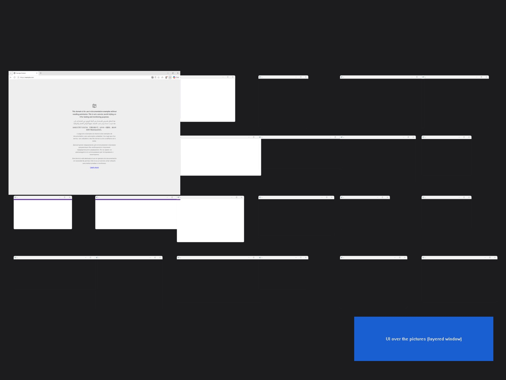

# Week-one spikes: results (2026-10-28)

Run in the UTM 5 VM:
- **System:** Windows 11 on Arm build 26300, on UTM's VirtIO GPU 3D (DirectX) driver.
- **Display:** 1600×1200 at 75 Hz.
- **Direct3D:** D3D11 feature level 11_0 on the virtual GPU.

Absolute frame numbers from a VM don't carry over to real hardware; the comparisons do. Code is
in `src/Spikes` (plus `bench` in Expanse itself); raw results are in `out/spike-*.json` in the VM.

## Recommendation

- **Pictures:** use **shared thumbnail visuals** (DirectComposition), with DWM thumbnails as the
  automatic fallback behind the same `IPictures` interface. Done since; see the follow-up
  below. Don't use Windows.Graphics.Capture for the canvas.
- **Parking:** park windows at their exact camera spots, fully off-screen. While the overlay is
  up, Expanse moves every off-screen window onto the screen underneath it, so GDI apps paint
  (already in the milestone). No 2 px strip.
- **Focus:** start every glide from input (the hotkey or a click on the overlay); those get focus
  directly. Keep the fallback chain (Alt tap, then `AttachThreadInput`) for glides Expanse starts
  on its own.
- **VM:** UTM 5 is good enough; VMware Fusion isn't needed. The DirectX driver works after one
  restart.

## 1. Window pictures

The camera swung between the overview and 2.5× closer for 8 seconds, with 27 windows and a panel
of our own UI over the pictures.

| Route | Works here | fps | p95 frame gap | Our cost per frame | DWM CPU | Our UI on top |
|---|---|---|---|---|---|---|
| DWM thumbnails | yes | 61 | 26 ms | 2.3 ms (27 calls into DWM) | 58% of a core | needs a second, layered window |
| Shared thumbnail visuals (`dwmapi` #147, undocumented) | yes, 27 of 27 | 68 | 19 ms | 0.09 ms (one transform + commit) | 20% | just another visual in our tree |
| Windows.Graphics.Capture | yes, 27 streams | n/a (we'd draw them) | | +75 MB memory | 20% | ours to draw |

Expanse's own `bench` (DWM thumbnails, 11 windows): 71 fps, p95 16 ms, 0.8 ms per frame.

**Why shared visuals next:**
- **One transform per frame.** The camera becomes a single transform that DWM applies to every
  picture at once. With thumbnails it's one cross-process call per picture, and those calls can
  land in different frames.
- **Our UI lives in the same tree.** Labels, the hover ring, the minimap and the selection box
  can sit over and between pictures without stacking extra windows.

The risk is that it's undocumented, so the ordinal and signature can change between Windows
builds. Mitigation: try it at start-up and fall back to DWM thumbnails.

**Why not WGC for the canvas:**
- It costs memory per stream, plus a texture per frame.
- We'd have to draw every picture ourselves, which DWM does for free.

In its favour, borderless capture is allowed without a prompt for an unpackaged app (no yellow
border appeared), and frames only arrive when a window changes. Keep it for what DWM can't do:
blur or glass effects, and snapshots.

## 2. Parking off-screen

Frames per second from each window's capture. Each window's content changes by itself, and the
other windows were moved out of the way so the subject was never covered.

| App (what changes) | On screen | Fully off-screen | 2 px strip | Back on screen |
|---|---|---|---|---|
| Edge, Chromium (requestAnimationFrame counter) | 36 | 36 | 37 | 36 |
| Windows Terminal (prints the time 10×/s) | 1.7 | 1.7 | 2 | 2 |
| File Explorer (folder whose files churn) | 1.7 | **0** | **0** | 1 |
| Plain Win32 GDI window (30 fps timer) | 21 | **0** | 21, but only the strip | 22 |

- **DirectX- and DirectComposition-drawn apps keep painting wherever they're parked.** Edge also
  kept rendering under our full-screen overlay: its counter went from 21,569 to 21,757 in about
  2.5 s. So Chromium's occlusion tracking didn't throttle it, at least on this build.
- **GDI drawing is clipped to the screen.** Off-screen pixels are never painted, so a window
  created off-screen has an empty picture. A 2 px strip refreshes only those 2 px. That rules out
  the strip trick.
- **WinUI apps redraw late.** The new Notepad, once parked, takes a second or two to redraw after
  being lifted under the overlay, so its picture is blank for that long. This is the same with both
  picture backends. A snapshot kept from before it was parked would cover the gap.
- **Windows never pulled a parked window back.** This was without display changes; those aren't
  tested yet.
- **The fix is in the milestone.** On zoom-out (and for glides), every off-screen window is moved
  onto the screen under the overlay; the hand-back puts each where the camera says. The GDI test
  windows went from blank to live.

Not tested:
- **VS Code (Electron).** Installing it with winget means accepting its licence. It's Chromium
  underneath, like Edge.
- **Notepad.** It was static, so it gave no signal.

## 3. Focus: `SetForegroundWindow`

| Trigger | Result |
|---|---|
| No input: a process started by Task Scheduler, or a fresh Expanse given a command over the pipe | Refused; works after a dummy Alt tap |
| Hotkey (Ctrl+Alt+`) → the overlay | Direct, 4 of 4 |
| Click on the overlay → the picked window | Direct, 5 of 6 |
| Pipe command after Expanse got the last input | Direct ("the process that received the last input" rule) |

The one refused click came straight after an Alt-tap fallback. That Alt tap put the overlay into
Windows' menu mode. The overlay now ignores `SC_KEYMENU`, and the same sequence focuses directly
since (2 of 2).

Input was injected with `SendInput` inside the VM, which these rules treat like hardware input.
The Mac's keyboard and trackpad through UTM aren't tested yet, because UTM only forwards input
while it's the active app.

## Learned about the VM

- **Display driver:** the guest tools' display driver needs a Windows restart. Before it, DWM
  half-drew windows and the clock stood still.
- **OpenSSH:** Windows' own OpenSSH feature sat queued behind a cumulative update for 25+ minutes
  on the fresh install. Microsoft's Win32-OpenSSH MSI took seconds. Its SFTP subsystem fails
  here, but `scp -O` works.
- **Disk:** the VM's C: drive has about 15 GB free.

## Follow-up: Expanse on shared visuals (same day)

Expanse now draws its canvas with shared visuals, falling back to DWM thumbnails (tested by
forcing every shared visual to fail: `ctl pictures shared-fail`). The `bench` was run twice per
backend, with 10 windows, in the same session:

| Backend | fps | p95 frame gap | Worst gap | Our cost per frame | DWM CPU |
|---|---|---|---|---|---|
| DWM thumbnails | 52–59 | 26–33 ms | 117–119 ms | 1.1–1.6 ms | 48–58% |
| Shared visuals | 63 | 23–25 ms | 45–53 ms | 0.12 ms | 32–34% |

- **Zoom-out and dive timings are noisy in the VM for both backends:** 4 to 14 frames for a
  0.2 s animation, at 75 Hz.
- **A Windows toast can sit above our topmost overlay.** The OneDrive one did.

## Next

1. ~~Live window tracking (`SetWinEventHook`)~~: done, along with the glide when the taskbar or
   Alt-Tab focuses a parked window, and the tray icon.
2. ~~Hops on Ctrl+Alt+arrows; the layout maths ported with its tests~~ and ~~drag with snapping,
   Tidy Up, new windows in free space~~: done. Still to come:
   - ~~The rest of the zoomed-out controls: box-select, Shift-click and group drag, the close
     button, zoom keys, wheel and Space-drag pan~~: done.
   - ~~Rings and close buttons drawn over every picture~~: each picture now has its own layer
     for them, right above it in the canvas, so a window in front covers them.
   - **The VM's display resets to the UTM window's size** (800×600 lately) every so often, even
     after `Guest res`; tests that click at fixed spots should set it right before.
   - ~~The saved layout, the home layout for smaller screens, Restore Layout~~: done.
   - **Taskbar previews and notifications** can sit above the overlay.
   - ~~Restoring a minimised window that was parked off-screen came back once at 1/1.25 of its
     size~~: not reproduced since (Explorer, Notepad and a maximised Settings window, parked, at
     125%, minimised and restored), but the path had a real bug: a window coming back was made
     afresh, losing where it was before Expanse moved it (so quitting didn't put it back), its home
     spot, its chosen size (taken from whatever size it came back at, which a fit then enforced:
     the likely cause) and its maximised state. It keeps its record now.
3. ~~Dialogs move with their owner; maximised windows~~: done. Notes:
   - **Owned windows** are found by walking `GW_OWNER` (GetAncestor's GA_ROOTOWNER only follows
     popups' owners). Only ones with a title bar count, so tooltips, menus and drop-downs don't.
   - **A maximised window can't be moved** with SetWindowPos: it stays at the screen's origin. It
     is restored (SetWindowPlacement, its normal rect set to where it is) to move it, and
     maximised again at its spot, with your own normal rect put back.
   - **A taskbar click on a window with a dialog up** reports the taskbar as the foreground
     change and activates the dialog without an event, so focus handling looks at the window in
     front when things settle rather than the last event's.
   - **SetForegroundWindow can accept** yet take more than 50 ms to show (just after a maximise):
     tapping Alt then lands in the window and WinUI apps show their key tips, so an accepted
     switch is given 250 ms.

4. ~~Admin windows~~: done. Notes:
   - **The VM had UAC off** (EnableLUA 0) from its install, so everything ran as administrator and
     nothing was "admin". It's on now, as on a normal PC.
   - **A normal program can't move an admin window:** SetWindowPos fails with access denied
     (error 5), checked from a medium-integrity PowerShell. Integrity levels are read from each
     window's process token; one that can't be read counts as above Expanse.
   - **Run normally, Expanse leaves admin windows off the canvas** (and their dialogs), and the
     tray icon says so once. Keeping them on the canvas would mean pictures of windows it can't
     place, whose spots follow the camera.
   - **Include Admin Windows** restarts Expanse as administrator (ShellExecuteEx "runas"). The two
     hand over: the new one waits on the single-instance mutex; the old one saves the layout
     marked `handOver` and keeps originals.json; the new one adopts it instead of treating it as a
     crash. Going back to normal goes through Explorer (anything an elevated process starts is
     elevated), and puts admin windows back first, so none is left parked off screen.
   - **Run as administrator, the command pipe allows only SYSTEM and Administrators**: a
     medium-integrity expansectl gets access denied (checked), so other programs can't reach admin
     windows through Expanse.
   - **Both switches are tested end to end:** to administrator from the tray menu (Matthew
     clicked Yes on the UAC prompt) and back (`ctl admin`). Not yet: starting with the setting on,
     which asks at start.
   - **Run normally, Expanse forgets admin windows' saved spots.** Kept, switching to
     administrator later moved an admin window from where you'd been using it back to a spot
     saved in an earlier admin session (off screen, in the test).

5. ~~Several monitors and scaling~~, to the Mac's level (it doesn't do several displays yet; it
   handles changes of resolution, size and monitor). Notes:
   - **Scaling changes** come as WM_DPICHANGED (and a work-area change). Windows grew File
     Explorer by 1.25 and Expanse's fit then shrank it back to its chosen size in pixels; Notepad,
     parked off screen, wasn't rescaled at all. Now the canvas scales with the DPI (spots about the
     middle of the view, chosen sizes, home spots, saved entries), so the fit agrees with Windows
     and resizes the windows it skipped. 125% -> 100% -> 125% came back to within a pixel. Layouts
     record their DPI and are converted on load.
   - **Main screen only:** a window that turns up on another monitor (and not on the main screen)
     isn't taken on, unless Expanse had it before (minimised, or saved by handle); one moved onto
     another monitor leaves the canvas; one moved back joins where it's dropped. A window off every
     screen is taken on: left alone it would be out of reach.
   - **Parking:** a window wholly off the main screen whose spot is on another monitor, or nearer
     one than the main screen (it'd take that monitor's scaling), waits 32 px past an edge of the
     main screen that no other monitor reaches past at all, the side it's heading first. Clear at
     its present size isn't enough: in the test a Notepad parked below the main screen grew by
     1.25 as Windows rescaled it back to the main screen's scaling, reached the second monitor's
     corner (1080 tall beside 900), and was taken for moved there.
   - **Tested with a real second monitor at mixed scaling:** the main screen 1440x900 at 125%, a
     Virtual Display Driver monitor 1920x1080 at 150% to its right. Parked windows all wait above
     the main screen; a window moved onto the 150% monitor leaves the canvas (Windows rescales it
     by 1.2) and comes back at its own size; one opened there is left alone; zoomed out, the other
     monitor is untouched. Also with a pretend one (`ctl monitor X Y W H`).
   - **Known gaps:** a window straddling the main screen's edge shows on the neighbouring monitor,
     and if most of it is there and that monitor's scaling differs, Windows rescales it (seen: a
     Notepad went 1426 -> 1142 wide; the canvas follows its size at the next sync). A maximised
     window is restored and maximised again during a display change (a flicker).
   - **The VM's second display:** UTM's own second display (`virtio-gpu-pci`) needs Red Hat's
     plain (non-3D) driver, and installing that on one card applied it to the main card too, so it
     was undone. The Virtual Display Driver (signed by SignPath, not Microsoft) is refused by Code
     Integrity on Arm, so the VM now has Secure Boot off and test signing on (Matthew's steps), and
     the driver installed from `C:\VirtualDisplayDriver`. UTM's SPICE agent (`vdservice`) resets the
     display layout to one screen whenever a display changes: stop it to test two (`Stop-Service
     vdservice`; it's back at the next boot), then extend (Settings > Display > Extend, or
     SetDisplayConfig with SDC_TOPOLOGY_EXTEND). The guest helper's `res W H N`, `scale P N` and
     `shotall` (`vm.sh shot FILE all`) take a display.

6. ~~Parity with the Mac app~~ (28 Oct, overnight): the minimised-window record (a window back
   from being minimised keeps where it was, its home spot, chosen size and maximised state), logs
   without titles plus Detailed Logging and Copy Logs, Show Window Names (off by default), the hot
   corner (every corner by default, as on the Mac; Matthew's call on 29 Oct over top-left only,
   since on Windows the top-right is where you fling the pointer to close a maximised window, and
   the bottom-right is Show Desktop), Centre Current Window and the
   auto-centre hotkey, Restore All Windows, Open at Login, clicking and scrolling the empty desktop
   (a low-level mouse hook on its own thread), the minimap, Welcome & Shortcuts, `expanse://`
   links, dialogs shown over the canvas, VM and remote-screen windows sizing themselves, and a view
   you placed staying put. Notes:
   - **Focus:** when Windows refuses a switch, tapping a key no app uses (VK 0xFF) unlocks the
     foreground as well as Alt does, without Alt's side effect: an Alt tap lands in the window in
     front, and WinUI apps (Notepad, Settings) show their key tips.
   - **Dialogs:** the Mac lowers the canvas under a dialog. On Windows a dialog is an ordinary
     window, not above the canvas, so it's the other way round: the asking dialog is made
     always-on-top for the while (and brought onto the screen if its window put it off it).
   - **Update checks and Report an Issue** (29 Oct), once the repo existed
     (github.com/invig/expanse-windows): see item 9.
   - **The Spaces panel is the Desktops panel**, for Windows' virtual desktops: the list, names
     and current one read from Explorer's registry key (polled twice a second while zoomed out),
     switching by pressing Win+Ctrl+arrows once per desktop (there's no public API). The canvas
     (a tool window) stays up across a switch; the old desktop's windows are cloaked and leave the
     canvas, the new one's come back to their spots. Tiles show the desktop picture.
   - **Mac backlog items, not built on either:** window size snapping, low-motion mode.
   - **DWM restarts** (the Mac's capture-service recovery): tested by killing `dwm.exe` in the VM,
     at 100% and zoomed out. Before the fix, the pointer read as being in the top-left corner while
     DWM was down (a false hot-corner zoom-out), frames came back with the invisible borders, and
     every picture failed, so Expanse fell back to DWM thumbnails for good. Now it watches
     `DwmIsCompositionEnabled`, waits a second after DWM's back, and makes new shared visuals
     (about 1.5 s in the VM).

7. ~~Taskbar previews over the overlay~~ (checked 28 Oct): the overlay covers the taskbar, so
   previews only show while the shell's own UI is up (Win opens Start and the taskbar over the
   canvas; Esc puts the canvas back on top and focused), as the Dock and Spotlight do over the
   Mac's canvas. Notifications show over it too, as on the Mac. Nothing to change.
8. **The Mac's recent fixes, checked on Windows** (28 Oct): a window back from full screen (F11)
   keeps its spot; a minimised window keeps its spot across an Expanse restart; the second
   monitor switched off and back (Win+P "second screen only"; UTM's display counts as external
   too, so the lid-close case, the main display going, can't be made in this VM): windows on it
   are minimised by Windows (its "Minimize windows when a monitor is disconnected" setting) and
   come back to their spots. One wrinkle: the Settings window maximised itself during the change
   and the fit moved one parked window 32 px to make room, which stayed after the round trip.
9. **Updates and releases** (29 Oct), a port of the Mac's Updater: once a day (and a minute after
   launch) Expanse asks GitHub for the repo's latest release, downloads
   `Expanse-<version>-windows-<arm64|x64>.zip` for its own processor, and checks it: the SHA-256
   GitHub lists for the asset, the version in the exe, and when the running copy is code-signed,
   the same publisher (WinVerifyTrust plus the signer's certificate). Install renames the running
   Expanse.exe (Windows allows that, not overwriting it), moves the new one in, starts it, and hands
   over as Include Admin Windows does, so nothing moves; the new copy deletes the old file. Release
   builds only (`ExpanseRelease` set by `scripts/release.sh`, which publishes single-file,
   self-contained, compressed builds: about 45 MB, 39 MB zipped). Tested in the VM with release
   builds 0.1.0 and 0.1.1 and a stand-in for GitHub on the Mac (`ctl update-source URL`): a wrong
   SHA-256 is refused; the right one installs, restarts as 0.1.1 in about 3 s, every window where
   it was. Against the real repo it says there's no release yet (GitHub answers 404 while the repo
   is private or has none). Not tested: the x64 build on an x64 PC, the tray's Check for Updates
   dialogs (the same code as `ctl update`), and installing from a folder you can't write to (it
   opens the release page instead).
10. **The Mac's 0.1.26 to 0.1.28** (29 Oct), and the display-change rework from 0.1.22 that the
    port had missed: the layout fixtures were from before it, so the Windows port's `derive` and
    `freeSpot` had drifted from the Mac's (77 and 24 cases) while its tests still passed. The oracle
    now extracts the Mac's anchors (`anchor`, `anchors`, `isNearest`, `anchorCandidates`) and `cap`
    too, with cases where capping to a smaller screen evens out widths (the column tie); all 13,196
    cases match. On top: home spots from neighbours (`HomeSpot`, `RehomeStrays`), fits that move
    windows only by the screen change (`FitPush`, the fitted size saved in layout.json), one 16 px
    margin applied only to windows bigger than the screen, sizes from Snap and shortcuts (a resize
    right after your click or key in that app, not Expanse's), saved spots only at launch or for an
    app that just started, an app's loading box centred on its window's spot, and the view staying
    put when Windows focuses the next window after a close or minimise. "Input" is a click (the
    mouse hook) or other input that wasn't the mouse's (GetLastInputInfo), so pointer moves don't
    count, as on the Mac; the first 300 ms after a close are the closing key being let go. Tested in
    the VM: a 1440x900 → 1024x640 → 1440x900 round trip comes back exactly; a restart on the same
    screen moves nothing; Win+Left's size is kept through a smaller screen; Alt+F4 leaves the view
    where it was; Ctrl+N in Explorer puts the new window beside you. Not tested: the loading box
    (no app here shows one). Not ported: the Mac's capture-service back-offs (macOS only).
11. **The Mac's 0.1.29 and 0.1.30** (29 Oct). Ported: a scroll at 100% snaps when it stops (the
    Mac's `snappedCamera`, measured against the work area; a 250 ms pause ends a wheel's scroll);
    window moves aren't followed while the screen is locked or the displays are off, and every
    window goes back where it was after; Restore Layout keeps the snapshot's home spots and, on the
    screen it was taken on, its exact positions; this desktop's tile goes back to 100%; and the
    canvas opens onto a live picture of the real desktop (a shared visual of Progman under the
    pictures), not the desktop picture drawn from its file, so icons stay and the picture is
    fitted as Windows fits it. Not needed: clickable desktop icons (clicks always went through
    here; only a click on empty desktop zooms out) and the see-through backdrop at 100% (there's
    no overlay at 100% here); a window restored from the taskbar after the view moved away was
    already glided to (the Mac's ⌘-Tab after hiding). Tested in the VM: the display going off
    (SC_MONITORPOWER) and on is noticed and moves nothing; the lock is noticed; a restore after
    Tidy Up gives back all six frames and home spots exactly; two wheel notches on a tidied layout
    snap by 95 and 64 px, lining Notepad and Terminal up a gap in (on an untidy layout, with
    windows 7 px apart, the Mac's scoring prefers pushing most windows out of sight: 893 px); the
    desktop picture costs nothing measurable (63 fps, p95 17 ms).
